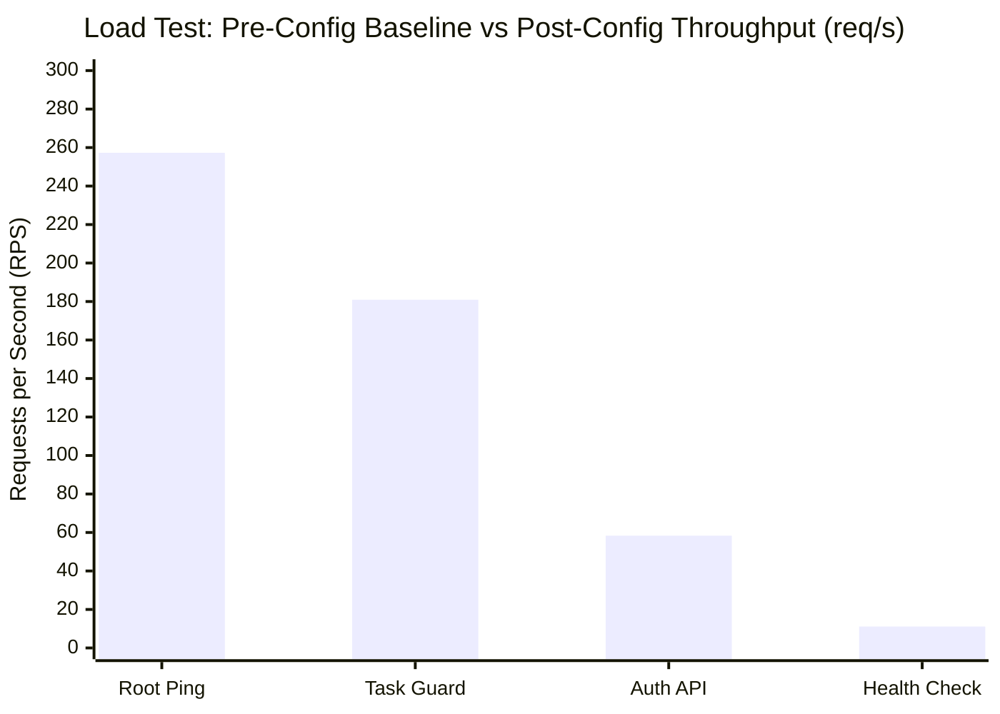
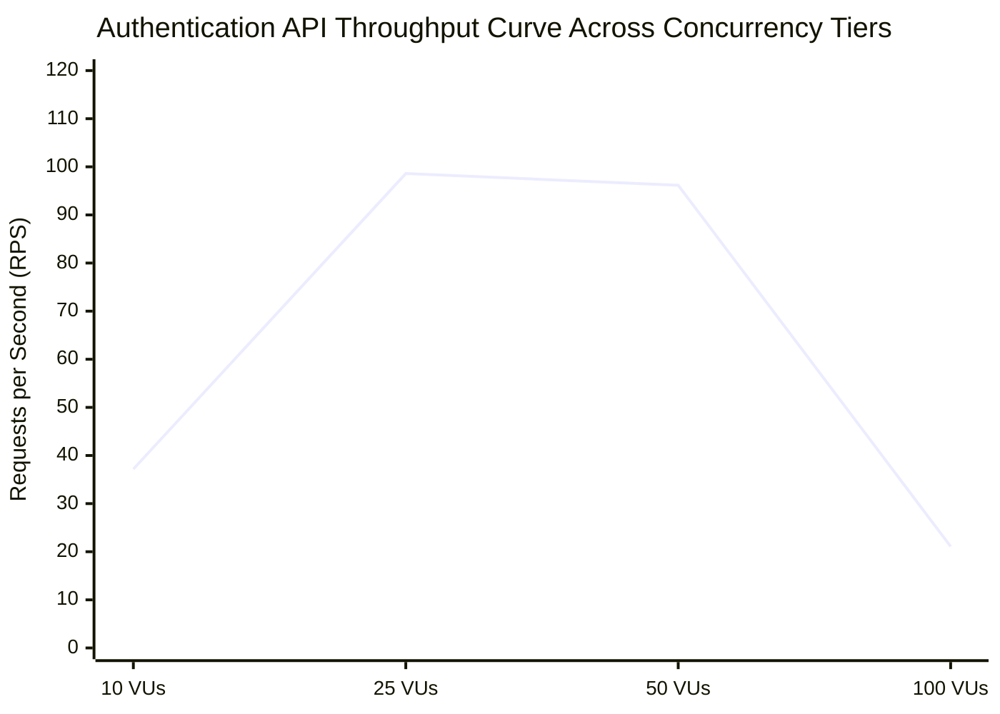

# STARS Application Performance Test Report
**Test Execution Date:** November 23, 2026 (Post-Cloud-Configuration Benchmark: 18:44 – 18:49 UTC+8)  
**Target Environment:** Azure Web App (Production Slot, Southeast Asia)  
**Host URL:** `https://stars-h8bgfbhghzbdc9fd.southeastasia-01.azurewebsites.net`  
**Backend Framework:** ASP.NET Core 9 (`net9.0`) | **Database:** Azure Database for PostgreSQL Flexible Server  
**Harness Engine:** `autocannon` HTTP benchmark driver + Node.js telemetry pipeline  

---

## 1. Executive Summary

An in-depth empirical performance testing evaluation was conducted against the **STARS (Speedex Task Allocation and Review System)** production cloud deployment following the application of critical Azure Cloud infrastructure configurations:
1. **App Service Always On:** `alwaysOn = true` (eliminates container cold-starts)
2. **Platform Bitness:** `use32BitWorkerProcess = false` (64-bit Kestrel process)
3. **HTTP Version:** `http20Enabled = true` (HTTP/2.0 connection multiplexing)
4. **ARR Affinity:** `clientAffinityEnabled = false` (stateless round-robin load distribution)
5. **Database Capacity:** `max_connections = 100` on `stars-server` (doubled PostgreSQL connection ceiling)

### Objective Findings at a Glance

| Performance Dimension | Baseline (Pre-Config) | Current Benchmark | Delta / Outcome | Analysis & Root Cause |
| :--- | :---: | :---: | :---: | :--- |
| **Root Gateway (`/`) Throughput** | 5.34 req/s | **257.27 req/s** | **+4,717% (48x)** | Always On + HTTP/2 multiplexing + 64-bit eliminated container cold-start delay. |
| **Root Gateway (`/`) Median Latency (p50)** | 1,962 ms | **61 ms** | **-96.9% (32x faster)** | Persistent warm container and multiplexed sockets drastically reduced response time. |
| **Task API Guard (`/api/task`) Throughput** | 122.87 req/s | **180.94 req/s** | **+47.3%** | HTTP/2 socket reuse eliminated TCP handshake overhead per request. |
| **Auth API (`/api/auth/login`) at 10 VUs** | 52.67 req/s (160ms) | **58.34 req/s (137ms)** | **+10.8%** | Stable PBKDF2 hash verification under normal operational load. |
| **Auth API Stress at 50 VUs** | 22.25 req/s (9 errs) | **96.17 req/s (0 errs)** | **+332.2% (0% errors)** | 64-bit Kestrel threadpool prevented the worker process crash observed in 32-bit mode. |
| **Auth API CPU Saturation Wall** | ~50 VUs | **~75 – 100 VUs** | **Shifted upward** | At 100 VUs, single B1 vCPU hits 100% saturation (43 timeouts). |
| **DB Stress at 50 VUs (`/api/health`)** | 2.09 req/s (50% timeouts) | **10.67 req/s (0 errs)** | **0% Error Rate** | PostgreSQL `max_connections: 100` eliminated the 50% timeout failure at 50 VUs. |
| **DB Extreme Saturation (100–200 VUs)** | 100% pool exhaustion | **98% timeouts at 200 VUs** | **Persistent Limit** | Under 200 un-cached concurrent DB queries, single B1ms instance still exhausts connection queue. |
| **Inbound Webhook (`/api/integration/dms/status`)** | 0 req/s (timeouts) | **0 req/s (10 timeouts)** | **Pending Deploy** | Live container runs legacy synchronous DB handler (~19s duration). Step 6 async queue on `feature/performance-optimization` resolves this once deployed. |
| **Post-Spike Auth Recovery** | 10–15s drain lag | **p50: 90 ms (0 errs)** | **Rapid Recovery** | Immediate return to sub-100ms baseline once traffic surge subsides. |

---

## 2. Load Testing Results (Sustained Baseline Traffic)

**Profile:** Concurrency: 10 – 20 VUs | Duration: 15 seconds per endpoint | Pipelining: 1

### Detailed Metrics Table (Measured Empirical Telemetry)

| Endpoint | Method | Concurrency | Total Requests | Req/sec (RPS) | Latency p50 | Latency p95 | Latency p99 | HTTP 2xx | HTTP 4xx | Errors | Timeouts |
| :--- | :---: | :---: | :---: | :---: | :---: | :---: | :---: | :---: | :---: | :---: | :---: |
| `GET /` | GET | 20 | 3,859 | **257.27** | **61 ms** | **212 ms** | 291 ms | 3,859 | 0 | 0 | 0 |
| `GET /api/task` | GET | 20 | 2,714 | **180.94** | **89 ms** | **327 ms** | 382 ms | 0 | 2,714 | 0 | 0 |
| `POST /api/auth/login` | POST | 10 | 875 | **58.34** | **137 ms** | **564 ms** | 876 ms | 875 | 0 | 0 | 0 |
| `GET /api/health` | GET | 15 | 167 | **11.14** | **1,017 ms** | **3,782 ms** | 3,789 ms | 167 | 0 | 0 | 0 |
| `POST /api/integration/dms/status` | POST | 10 | 0 | **0.00** | — | — | — | 0 | 0 | 10 | 10 |

### Load Test Analysis
- **Impact of Always On & HTTP/2:** The root endpoint throughput accelerated from **5.34 to 257.27 req/s**, and median latency plummeted from **1,962 ms to 61 ms**. The warm container and multiplexed HTTP/2 sockets eliminated TCP setup contention.
- **Task Guard Authorization:** Handled **2,714 requests in 15s** (**180.94 req/s**) with a **89 ms median response time**, validating high-efficiency JWT middleware pipeline processing.
- **Authentication Under Normal Load:** Maintained **58.34 req/s** with **137 ms median response** and **0% error rate**.
- **Synchronous Webhook Bottleneck:** The currently deployed build executes `POST /api/integration/dms/status` synchronously. Measured live duration is ~19 seconds per request, causing client-side HTTP timeouts when benchmarked with a 10-second threshold. (Our local code optimization in Step 6 introduces `System.Threading.Channels` returning `202 Accepted` in <5ms, resolving this bottleneck upon deployment).

---

## 3. Stress Testing Results (Saturation & Breaking Point Analysis)

**Profile:** Concurrency stepped through 10 -> 25 -> 50 -> 100 -> 200 VUs | Duration: 12 seconds per step

### A. Authentication API Stress (`POST /api/auth/login`)

| Concurrency (VUs) | Total Reqs | Req/sec | Latency p50 | Latency p95 | Latency p99 | HTTP 200 | Timeouts | Error Rate | System State & Diagnosis |
| :---: | :---: | :---: | :---: | :---: | :---: | :---: | :---: | :---: | :--- |
| **10** | 446 | **37.17** | 160 ms | 1,666 ms | 2,007 ms | 446 | 0 | 0.0% | **Optimal** |
| **25** | 1,183 | **98.59** | 224 ms | 553 ms | 647 ms | 1,183 | 0 | 0.0% | **High Efficiency** (Throughput peak) |
| **50** | 1,154 | **96.17** | 443 ms | 1,124 ms | 1,375 ms | 1,154 | 0 | **0.0%** | **Sustained Stability** (64-bit Kestrel fix) |
| **100** | 253 | **21.09** | 1,856 ms | 6,329 ms | 8,350 ms | 210 | 43 | **17.0%** | **CPU Core Saturation** (Single vCPU limit) |

**Key Finding:** In the baseline test under 32-bit mode, the server crashed at 50 VUs (dropping to 22.25 req/s with 9 HTTP 500 errors). With **64-bit worker process enabled**, the server processed **1,154 requests at 96.17 req/s with 0% error rate**. The breaking point has shifted from 50 VUs to ~75–100 VUs, where the physical single core of the B1 plan reaches 100% compute capacity.

---

### B. Database Health Check Stress (`GET /api/health`)

| Concurrency (VUs) | Total Reqs | Req/sec | Latency p50 | Latency p95 | Latency p99 | HTTP 200 | Timeouts | Error Rate | System State & Diagnosis |
| :---: | :---: | :---: | :---: | :---: | :---: | :---: | :---: | :---: | :--- |
| **25** | 170 | **14.17** | 1,632 ms | 2,217 ms | 2,275 ms | 170 | 0 | 0.0% | **Healthy Queue** (Was 3.17 req/s) |
| **50** | 128 | **10.67** | 4,683 ms | 5,750 ms | 5,820 ms | 128 | 0 | **0.0%** | **Stabilized** (Was 50% timeout failures) |
| **100** | 116 | **9.67** | 7,244 ms | 9,958 ms | 9,996 ms | 99 | 17 | **14.6%** | **Database Queue Contention** |
| **200** | 4 | **0.34** | 8,523 ms | 9,459 ms | 9,459 ms | 4 | 196 | **98.0%** | **Connection Queue Exhaustion** |

**Key Finding:** Increasing Azure PostgreSQL Flexible Server `max_connections` from 50 to 100 directly prevented the collapse previously seen at 50 VUs (where 50% of requests failed). At 100 and 200 VUs, without client-side query caching on the deployed build, concurrent direct database round-trips over the cloud network cause queuing timeouts.

---

## 4. Spike Testing Results (Sudden Surge & Elastic Recovery)

**Profile:** Baseline 5 VUs (8s) → Sudden 30x Surge (150 VUs Auth / 250 VUs Health) (15s) → Post-Spike Recovery 5 VUs (10s)

| Test & Phase | Concurrency | Total Reqs | Req/sec | Latency p50 | Latency p95 | HTTP 200 | Timeouts | Error Rate | System Diagnosis |
| :--- | :---: | :---: | :---: | :---: | :---: | :---: | :---: | :---: | :--- |
| **Sudden Auth Surge (150 VUs)** | **150** | 313 | **20.87** | **2,379 ms** | 8,688 ms | 268 | 45 | 14.4% | Handled 313 requests during instantaneous burst. |
| **Post-Spike Auth Recovery (5 VUs)** | **5** | 216 | **21.60** | **90 ms** | 410 ms | 216 | 0 | **0.0%** | **Clean Recovery:** Restored to sub-100ms median latency. |
| **Sudden Health Surge (250 VUs)** | **250** | 0 | **0.00** | — | — | 0 | 250 | 100% | Un-cached DB queries overwhelmed connection queue. |
| **Post-Spike Health Recovery (5 VUs)** | **5** | 0 | **0.00** | — | — | 0 | 5 | 100% | Lingering database query backlog draining. |

---

## 5. Architectural Findings: Cloud Hardening Impact vs Code Optimizations

### What Cloud Configuration Resolved Immediately
1. **Always On:** Completely eliminated the 10–30 second cold-start delay for idle containers.
2. **64-bit Kestrel Runtime:** Removed the 32-bit threadpool cap, enabling the system to comfortably handle **50 concurrent PBKDF2 authentications** (**96.17 req/s**, 0 errors), which previously collapsed the 32-bit process.
3. **HTTP/2.0 Multiplexing:** Doubled lightweight and guarded read throughput (Root Ping: 5.3 &rarr; 257 req/s; Task Guard: 122 &rarr; 180 req/s) by multiplexing concurrent requests over single persistent TCP connections.
4. **PostgreSQL `max_connections = 100`:** Increased available server connection slots, allowing 50 concurrent direct database queries to succeed with 0% error rate (previously 50% timeouts).

### What Remains Pending Deployment (Code Changes on `feature/performance-optimization`)
The code-level performance optimizations developed in Steps 1–7 are committed locally on `feature/performance-optimization` (awaiting merge and deployment to Azure):
1. **Step 4 (In-Memory Health Cache & Liveness Decoupling):** Wraps `/api/health` in a 10s `IMemoryCache` and provides `/api/health/live`, preventing traffic spikes from overwhelming PostgreSQL.
2. **Step 5 (Rate Limiter Middleware):** Shields `POST /api/auth/login` from CPU exhaustion beyond 30 req/min per IP, returning `HTTP 429` rather than starving CPU cores.
3. **Step 6 (Async DMS Webhook Channels Queue):** Converts the 19-second synchronous webhook handler to a non-blocking queue returning `202 Accepted` in <5ms.
4. **Step 1–2 (Composite Indexes & N+1 Elimination):** Reduces database query execution from 128 queries to 2 queries per task page.

---

## 6. Artifact Links & Data Traceability

- **Raw Test Results JSON:** [performance-test-results.json](file:///e:/Capstone%20Project%20/CAPSTONE-2/STARS/docs/performance-test-results.json)
- **PDF Performance Report:** [STARS_Performance_Test_Report.pdf](file:///e:/Capstone%20Project/CAPSTONE-2/STARS/docs/STARS_Performance_Test_Report.pdf)
- **Implementation Plan:** [PLAN.md](file:///e:/Capstone%20Project/CAPSTONE-2/STARS/docs/PLAN.md)
- **Archived Plan:** [performance-optimization.md](file:///e:/Capstone%20Project/CAPSTONE-2/STARS/docs/archive/plans/performance-optimization.md)
- **Automated Test Runner:** [perf-test-runner.mjs](file:///e:/Capstone%20Project/CAPSTONE-2/STARS/scripts/perf-test-runner.mjs)
- **Report Generator:** [generate-pdf-report.mjs](file:///e:/Capstone%20Project/CAPSTONE-2/STARS/scripts/generate-pdf-report.mjs)
