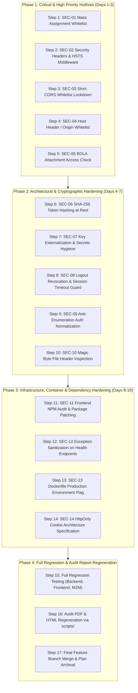

# Plan: STARS Security Audit Remediation & Verification

**Feature Branch:** `feature/security-audit-remediation` | **Base Branch:** `refactoring/bug-fix`  
**Step Branches:** `step-N-<short-name>`  
**Safety Guardrails:**  
- **Do not code yet:** Await explicit approval before commencing implementation steps.
- **Never push directly to `refactoring/bug-fix`:** Always commit to isolated step branches and merge into `feature/security-audit-remediation`.
- **Local Git Only:** Do NOT push any branches or commits to GitHub remote.
- **Strict Regression Testing:** Pre-commit and pre-merge verification using `dotnet test` (1070 baseline) and `npm test` (500 baseline).
- **Post-Remediation Verification & Report Regeneration:** Execute `node scripts/generate-security-audit-pdf.mjs` to regenerate `docs/STARS_Security_Audit_Report.pdf` and `docs/security-audit-report.html` with identical formatting.

---

## 1. Executive Summary & Audit Baseline Analysis

A comprehensive security audit documented in `docs/STARS_Security_Audit_Report.pdf` (and `docs/SECURITY_AUDIT_REPORT.md`) identified **14 total vulnerabilities**:
- **1 Critical Risk:** Mass assignment privilege escalation in user profile updates (SEC-01).
- **5 High Risk:** Missing security headers & HSTS (SEC-02), overly permissive CORS wildcard (SEC-03), host header/origin link poisoning (SEC-04), BOLA/IDOR on attachments (SEC-05), plaintext token storage at rest (SEC-06).
- **6 Medium Risk:** Committed integration API keys (SEC-07), session resuscitation on logout (SEC-08), authentication error user enumeration (SEC-09), extension-only file upload validation (SEC-10), vulnerable frontend npm dependencies (SEC-11), health/verification information disclosure (SEC-12).
- **2 Low / Informational Risk:** Docker production development flag (SEC-13), localStorage token persistence (SEC-14).

### Baseline Test Status (Pre-Remediation Gate)
- **Backend (.NET 9):** 1,070 passed, 0 failed (`dotnet test backend/Tests/Backend.Tests.csproj --configuration Release`).
- **Frontend (Vitest / React 18):** 500 passed across 50 test files (`npm --prefix frontend test -- --run`).
- **M2M Integration:** `api-integration-tests/test-stars-foms-e2e.mjs`.

---

## 2. Remediation Architecture & Phased Roadmap



---

## 3. Detailed Step-by-Step Implementation Steps

### Phase 1: Critical & High Priority Hotfixes

- [x] **Step 1: Fix Mass Assignment Privilege Escalation in Profile & User Updates (SEC-01)**
  - **Targets:**
    - `backend/Modules/UserAccountManagement/UserService.cs` (lines 344–349, 439–446)
    - `backend/Controllers/ProfileController.cs`
    - `backend/Controllers/UserController.cs`
  - **Remediation Action:**
    - In `UserService.UpdateAsync`, inspect whether the requesting caller possesses the `Manager` role.
    - If `requestUserId == id` (self-profile update) or caller is not a `Manager`, explicitly strip privilege-bearing fields: nullify `dto.Role`, `dto.DepartmentId`, `dto.JobPositionId`, and `dto.TargetSystems`.
    - Prevent regular employees (Courier, Dispatcher, Encoder) from self-elevating to Manager or moving their department/systems.
  - **Tests & Verification:**
    - Add unit tests in `backend/Tests/UserAccountManagement/UserSecurityTests.cs`:
      - Verify non-manager self-update ignores `Role` in payload and preserves existing role.
      - Verify manager caller can successfully update role and department.
    - Run `dotnet test backend/Tests/Backend.Tests.csproj --configuration Release`.
  - **Branch:** `step-1-sec01-mass-assignment`

- [x] **Step 2: Security Headers & HSTS Middleware Implementation (SEC-02)**
  - **Targets:**
    - `backend/Program.cs`
    - `frontend/nginx.conf`
  - **Remediation Action:**
    - Add custom middleware in `Program.cs` injecting protective headers:
      - `X-Frame-Options: SAMEORIGIN`
      - `X-Content-Type-Options: nosniff`
      - `Referrer-Policy: strict-origin-when-cross-origin`
      - `Content-Security-Policy`: Restrict scripts, styles, frames, and connect endpoints to authorized sources.
      - `Permissions-Policy: camera=(), microphone=(), geolocation=()`
    - Add `app.UseHsts()` when running outside Development (`!app.Environment.IsDevelopment()`).
    - Mirror equivalent headers in `frontend/nginx.conf` for reverse proxy consistency.
  - **Tests & Verification:**
    - Add integration test verifying HTTP response headers on live endpoints.
    - Verify all existing backend & frontend tests pass cleanly.
  - **Branch:** `step-2-sec02-security-headers`

- [x] **Step 3: Strict CORS Whitelist Lockdown (SEC-03)**
  - **Targets:**
    - `backend/Program.cs` (lines 33–54)
  - **Remediation Action:**
    - Remove the wildcard `.EndsWith(".vercel.app")` suffix match which permitted arbitrary attacker-controlled Vercel domains with credentials.
    - Replace with an exact canonical whitelist:
      - `https://stars-two-chi.vercel.app`
      - `https://speedex-system.vercel.app`
      - `https://delivery-system-capstone-beige.vercel.app`
      - `https://fomsfrontend.vercel.app`
      - In Development only: `http://localhost:5173`, `http://localhost:3000`, `http://127.0.0.1:5173`, `http://127.0.0.1:3000`.
  - **Tests & Verification:**
    - Add unit tests testing the CORS origin evaluator with valid origins (accepted) and arbitrary `.vercel.app` origins (rejected).
    - Run `dotnet test backend/Tests/Backend.Tests.csproj --configuration Release`.
  - **Branch:** `step-3-sec03-cors-whitelist`

- [x] **Step 4: Host Header & Origin Link Sanitization in Email Verification (SEC-04)**
  - **Targets:**
    - `backend/Controllers/EmailVerificationController.cs` (lines 110–133)
  - **Remediation Action:**
    - In `EmailVerificationController.GetClientBaseUrl()`, enforce domain validation against an approved origin host whitelist (matching `AllowedOriginHosts` pattern in `AuthController.cs`).
    - Reject arbitrary spoofed `Origin` and `Referer` headers; fallback strictly to configured `_frontendUrl`.
  - **Tests & Verification:**
    - Add unit test sending `POST /api/email-verification/resend` with spoofed `Origin: https://evil.com`; verify generated email verification URL points strictly to canonical frontend.
    - Run `dotnet test backend/Tests/Backend.Tests.csproj --configuration Release`.
  - **Branch:** `step-4-sec04-origin-sanitization`

- [x] **Step 5: Broken Object-Level Authorization (BOLA/IDOR) on Task Attachments (SEC-05)**
  - **Targets:**
    - `backend/Controllers/AttachmentController.cs` (lines 52–67)
    - `backend/Modules/TaskManagement/AttachmentService.cs`
  - **Remediation Action:**
    - In `GET /api/attachments/{id:guid}/download`, extract authenticated user ID and role claims.
    - Retrieve parent task metadata and verify the requesting user has legitimate access:
      1. User is `Manager`, OR
      2. User belongs to `task.AssignedDepartmentId`, OR
      3. User is actively assigned to the task (`task.Assignments.Any(a => a.AssignedUserId == userId)`).
    - If unauthorized, return `403 Forbidden`.
  - **Tests & Verification:**
    - Add unit tests in `backend/Tests/TaskManagement/AttachmentSecurityTests.cs`:
      - Cross-department unauthorized employee downloading attachment returns 403 Forbidden.
      - Assigned employee or Manager receives 200 OK with file content.
    - Run `dotnet test backend/Tests/Backend.Tests.csproj --configuration Release`.
  - **Branch:** `step-5-sec05-attachment-bola`

---

### Phase 2: Architectural & Cryptographic Hardening

- [x] **Step 6: Cryptographic Hashing of Tokens at Rest (SEC-06)**
  - **Targets:**
    - `backend/Models/User.cs` (`RefreshToken`, `PasswordResetToken`, `EmailVerificationToken`)
    - `backend/Modules/AuthenticationAndCredentials/AuthService.cs`
  - **Remediation Action:**
    - Update `AuthService` token generation: produce raw cryptographically secure random tokens for client communication, but store only their `SHA256` hexadecimal hashes in the database.
    - Update lookup queries (`RefreshTokenAsync`, `ResetPasswordAsync`, `VerifyEmailAsync`) to hash incoming client tokens prior to querying EF Core.
    - Ensure existing user records remain compatible or are handled smoothly.
  - **Tests & Verification:**
    - Run authentication test suite (`backend/Tests/AuthenticationAndCredentials/`) to verify login, token rotation, and password reset flows pass with hashed persistence.
    - Run `dotnet test backend/Tests/Backend.Tests.csproj --configuration Release`.
  - **Branch:** `step-6-sec06-token-hashing`

- [x] **Step 7: Key Rotation & Integration Secrets Externalization (SEC-07)**
  - **Targets:**
    - `backend/appsettings.json` (lines 64–65)
    - `docker-compose.yml`
    - `.env.example`
  - **Remediation Action:**
    - Remove hardcoded 64-character hexadecimal API keys (`OutboundApiKey`, `InboundApiKey`) from `appsettings.json`.
    - Configure keys to be loaded via standard environment variable bindings (`FomsIntegration__OutboundApiKey`, `FomsIntegration__InboundApiKey`).
    - Replace default passwords in docker-compose templates with secure placeholder references (`change_in_production`).
  - **Tests & Verification:**
    - Run M2M integration script `node api-integration-tests/test-stars-foms-e2e.mjs` with environment variables to verify externalized credentials work seamlessly.
    - Run `dotnet test backend/Tests/Backend.Tests.csproj --configuration Release`.
  - **Branch:** `step-7-sec07-secret-externalization`

- [ ] **Step 8: Token Revocation on Logout & Session Resuscitation Guard (SEC-08)**
  - **Targets:**
    - `backend/Modules/AuthenticationAndCredentials/AuthService.cs` (line 364)
    - `backend/Middleware/SessionTimeoutMiddleware.cs` (lines 66–90)
    - `backend/Models/User.cs`
  - **Remediation Action:**
    - Add a `TokenVersion` integer counter to `User` entity or register revoked JWT `jti` in `IMemoryCache` with expiration matching token lifetime.
    - In `SessionTimeoutMiddleware`, fix the resuscitation logic: if `!user.LastActivityAt.HasValue`, treat the session as explicitly terminated/logged out, return `401 Unauthorized`, and do NOT re-populate `LastActivityAt`.
  - **Tests & Verification:**
    - Add test making an authenticated call immediately after `/api/auth/logout`; verify `401 Unauthorized` is returned and `LastActivityAt` remains unset.
    - Run `dotnet test backend/Tests/Backend.Tests.csproj --configuration Release`.
  - **Branch:** `step-8-sec08-session-revocation`

- [ ] **Step 9: User & Account State Enumeration Elimination (SEC-09)**
  - **Targets:**
    - `backend/Modules/AuthenticationAndCredentials/AuthService.cs` (lines 148–186)
    - `backend/Controllers/AuthController.cs` (lines 134–143)
  - **Remediation Action:**
    - Normalize `ForgotPasswordAsync`: always return a generic success message: *"If an account matches the provided details, instructions to reset your password have been sent to your registered email address."* regardless of whether the employee number or email was found or active.
    - Protect `GET /api/auth/onboarding-status/{employeeNumber}`: require authentication or rate-limit and sanitize responses to prevent automated employee number scanning.
  - **Tests & Verification:**
    - Unit tests validating identical response messages and HTTP status codes for existing vs non-existent employee accounts.
    - Run `dotnet test backend/Tests/Backend.Tests.csproj --configuration Release`.
  - **Branch:** `step-9-sec09-anti-enumeration`

- [ ] **Step 10: File Upload Magic Byte Inspection (SEC-10)**
  - **Targets:**
    - `backend/Modules/TaskManagement/AttachmentService.cs` (lines 167–181)
    - `backend/Modules/Notifications/AnnouncementService.cs` (lines 95–110)
  - **Remediation Action:**
    - Extend `ValidateFile()` to inspect the file stream's magic byte header before accepting the upload:
      - PDF: `%PDF-` (`25 50 44 46`)
      - PNG: `\x89PNG\r\n\x1a\n` (`89 50 4E 47 0D 0A 1A 0A`)
      - JPEG: `\xFF\xD8\xFF`
      - Office Open XML (.docx/.xlsx): `PK\x03\x04` (`50 4B 03 04`)
    - Reject uploaded files whose file extension does not match the actual magic byte signature.
  - **Tests & Verification:**
    - Unit tests uploading executable/text files renamed with `.pdf` and `.png` extensions; verify HTTP 400 rejection.
    - Unit tests uploading valid PDF/PNG byte streams; verify successful acceptance.
    - Run `dotnet test backend/Tests/Backend.Tests.csproj --configuration Release`.
  - **Branch:** `step-10-sec10-magic-bytes`

---

### Phase 3: Infrastructure, Container & Dependency Hardening

- [ ] **Step 11: Frontend Dependency Vulnerability Remediation (SEC-11)**
  - **Targets:**
    - `frontend/package.json`
    - `frontend/package-lock.json`
  - **Remediation Action:**
    - Run `npm audit fix` and upgrade `axios`, `vite`, and `@xmldom/xmldom` to secure stable versions.
    - Verify all dependencies are cleanly resolved without breaking Vite build pipelines or React 18 component rendering.
  - **Tests & Verification:**
    - Run `npm --prefix frontend test -- --run` (all 500 tests pass).
    - Run `npm --prefix frontend run build` (production build succeeds with 0 errors).
  - **Branch:** `step-11-sec11-frontend-deps`

- [ ] **Step 12: Information Disclosure Sanitization on Health & Error Endpoints (SEC-12)**
  - **Targets:**
    - `backend/Program.cs` (`/api/health`, line 331)
    - `backend/Controllers/EmailVerificationController.cs` (lines 49, 87, 106)
  - **Remediation Action:**
    - In `/api/health` and email verification error handlers, log full exception details with `ILogger`.
    - Return generic client error responses: `{ "status": "Degraded", "message": "Service temporarily unavailable" }` without leaking `ex.Message`, connection strings, or server file paths.
  - **Tests & Verification:**
    - Add tests verifying error response formatting when simulated database exceptions occur.
    - Run `dotnet test backend/Tests/Backend.Tests.csproj --configuration Release`.
  - **Branch:** `step-12-sec12-error-sanitization`

- [ ] **Step 13: Dockerfile Production Environment Flag (SEC-13)**
  - **Targets:**
    - `backend/Dockerfile` (line 13)
  - **Remediation Action:**
    - Change `ENV ASPNETCORE_ENVIRONMENT=Development` to `ENV ASPNETCORE_ENVIRONMENT=Production`.
    - Document development environment overrides via docker-compose configuration.
  - **Tests & Verification:**
    - Verify OpenAPI/Scalar documentation endpoints are disabled by default under production configuration.
    - Run `dotnet test backend/Tests/Backend.Tests.csproj --configuration Release`.
  - **Branch:** `step-13-sec13-dockerfile-production`

- [ ] **Step 14: Token Storage Hardening Architectural Migration Plan (SEC-14)**
  - **Targets:**
    - `docs/rfc-cookie-based-authentication.md`
  - **Remediation Action:**
    - Author an Architectural RFC detailing migration of auth tokens from `localStorage` to `HttpOnly`, `Secure`, `SameSite=Strict` cookies.
    - Outline backend Set-Cookie headers, CORS credential handling, and cross-portal silent token refresh protocol.
  - **Tests & Verification:**
    - Architectural review and documentation verification.
  - **Branch:** `step-14-sec14-cookie-rfc`

---

### Phase 4: Full Regression, Report Regeneration & Archival

- [ ] **Step 15: Full Regression Testing & Gate Checks**
  - **Verification Checklist:**
    - `dotnet test backend/Tests/Backend.Tests.csproj --configuration Release` (all 1070+ passing).
    - `npm --prefix frontend test -- --run` (all 500+ passing).
    - `npm --prefix frontend run build` (clean production build).
    - `node api-integration-tests/test-stars-foms-e2e.mjs` (M2M integration passing).
  - **Branch:** `step-15-regression-gates`

- [ ] **Step 16: Security Audit Report & PDF Regeneration**
  - **Targets:**
    - `scripts/generate-security-audit-pdf.mjs`
    - `docs/security-audit-report.html`
    - `docs/STARS_Security_Audit_Report.pdf`
    - `docs/SECURITY_AUDIT_REPORT.md`
  - **Remediation Action:**
    - Update audit findings status to `REMEDIATED` and sign-off statuses to `APPROVED`.
    - Run `node scripts/generate-security-audit-pdf.mjs` to regenerate `docs/STARS_Security_Audit_Report.pdf` using Microsoft Edge headless with the identical format and styling.
  - **Branch:** `step-16-audit-report-regeneration`

- [ ] **Step 17: Final Feature Branch Merge & Plan Archival**
  - **Remediation Action:**
    - Merge all step branches into `feature/security-audit-remediation`.
    - Verify zero changes pushed to GitHub remote.
    - Archive finalized plan into `docs/archive/plans/security-audit-remediation.md`.
  - **Branch:** `feature/security-audit-remediation`

---

## 4. Governance & Safety Rules Summary

1. **NO CODE MODIFICATIONS YET:** No application source files are modified during this turn.
2. **BRANCHING HIERARCHY:**
   ```
   refactoring/bug-fix (Base branch - NEVER direct push)
     └── feature/security-audit-remediation (Feature umbrella branch)
           ├── step-1-sec01-mass-assignment
           ├── step-2-sec02-security-headers
           ├── ...
           └── step-16-audit-report-regeneration
   ```
3. **REGRESSION ZERO TOLERANCE:** Every step branch must maintain 100% test pass rate (1070 backend tests, 500 frontend tests).
4. **LOCAL REPOSITORY ONLY:** Do not push to remote GitHub.
