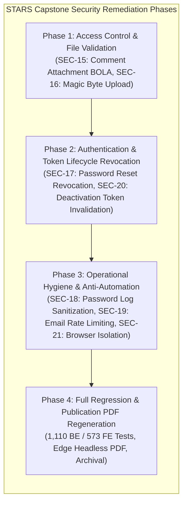

# Plan: STARS Capstone Security Penetration Remediation & Architecture Hardening
**Status:** COMPLETED & VERIFIED (All 8 Steps Implemented, 1,120 Backend Tests Passing, 573 Frontend Tests Passing, 21/21 Security Domains Verified)  
**Completion Date:** November 23, 2026  
**Feature Branch:** `feature/capstone-security-remediation` | **Base Branch:** `origin/refactoring/bug-fix`  
**Step Branches:** `step-N-<short-name>`  
**Safety & Workflow Guardrails:**  
- **Do not code yet:** Await explicit user approval before commencing implementation steps.
- **Always branch out of `origin/refactoring/bug-fix`:** Ensure the working branch originates cleanly from `origin/refactoring/bug-fix`.
- **Never push directly to `refactoring/bug-fix`:** Always commit to isolated step branches (`step-N-...`), run automated regression tests, and obtain explicit user verification and approval before merging back into `refactoring/bug-fix`.
- **Non-Breaking Code Guarantee:** Only change what is necessary; never introduce convoluted or speculative code. Implement straightforward, optimal solutions that preserve existing contracts.
- **Strict Pre-Commit & Pre-Merge Regression Testing:** Verify that all 1,110 backend unit tests (`dotnet test`) and 573 frontend unit tests (`npm test`) pass with zero regressions on every step.
- **Performance Preservation:** Ensure zero latency inflation and zero database round-trip regressions relative to the benchmarks in `docs/STARS_Performance_Benchmark_Report.pdf`.
- **Plan Archival Protocol:** Upon completion and verification of all steps, archive this implementation plan into `docs/archive/plans/capstone-security-penetration-remediation.md` for historical and audit context.

---

## 1. Executive Summary & Remediation Objectives

Following a comprehensive Capstone-grade security assessment combining Static Application Security Testing (SAST), Software Composition Analysis (SCA), OWASP ZAP dynamic profiles, and manual API penetration testing across all 31 controllers and 12 modules, 7 actionable findings (SEC-15 through SEC-21) were identified.

These findings build on the previously hardened baseline (SEC-01 through SEC-14) to elevate the system's security posture to the highest academic defense and enterprise production standards:



---

## 2. Vulnerability Remediation Work Breakdown Structure

### Phase 1: Access Control & File Upload Hardening (High Priority)

#### Step 1: SEC-15 — Broken Object-Level Authorization (BOLA/IDOR) on Task Comment Attachments
- **Target Files:**
  - `backend/Controllers/TaskCommentController.cs`
  - `backend/Modules/TaskManagement/TaskCommentService.cs`
  - `backend/Modules/TaskManagement/ITaskCommentService.cs`
- **Root Cause:**
  `TaskCommentController.DownloadAttachment` and `DownloadLegacyAttachment` retrieve files via attachment GUID without verifying whether the requesting user belongs to the task's assigned department, is an assigned assignee, the creator, or a Manager.
- **Implementation Details:**
  1. In `TaskCommentController.cs`, before executing `GetAttachmentAsync` or `DownloadLegacyAttachment`, verify caller authorization against the parent `taskId`.
  2. Implement `CanUserAccessTaskCommentAsync(Guid taskId, Guid userId, UserRole userRole)` in `TaskCommentService` or reuse existing `AttachmentService` task access logic.
  3. Reject unauthorized cross-department download requests with HTTP 403 Forbidden.
- **Optimal / Non-Breaking Guardrail:**
  Ensure authorized users (Managers, Task Creator, Assigned Users, and Members of the assigned Department) retain uninterrupted access to legitimate comment attachments.
- **Branch:** `step-1-sec15-comment-bola`
- **Verification Tests:**
  - Unit tests verifying that cross-department employees receive HTTP 403 when requesting comment attachment downloads.
  - Regression test verifying assigned team members successfully download attachments.

#### Step 2: SEC-16 — Magic Byte File Signature Verification on Task Comment Attachments
- **Target Files:**
  - `backend/Modules/TaskManagement/TaskCommentService.cs`
- **Root Cause:**
  `TaskCommentService.CreateAsync` inspects only file extension strings (`_fileSettings.AllowedFileTypes.Contains(extension)`), omitting binary magic byte validation.
- **Implementation Details:**
  1. In `TaskCommentService.CreateAsync`, call `FileSignatureValidator.HasValidMagicBytes(file)` for each uploaded file attachment.
  2. Reject files where the binary stream header does not match the declared extension (PDF, PNG, JPEG, Office) with HTTP 400 and clear error messaging.
- **Optimal / Non-Breaking Guardrail:**
  Rewind stream positions (`file.OpenReadStream().Position = 0`) before copying to disk to guarantee zero stream corruption.
- **Branch:** `step-2-sec16-comment-magicbytes`
- **Verification Tests:**
  - Unit tests uploading disguised `.exe` / `.sh` files with `.pdf` extension expecting rejection.
  - Verification test uploading genuine PDF and PNG attachments expecting success.

---

### Phase 2: Authentication & Session Lifecycle Revocation (High / Medium Priority)

#### Step 3: SEC-17 — Session & Token Invalidation on Password Reset and Password Change
- **Target Files:**
  - `backend/Modules/AuthenticationAndCredentials/AuthService.cs`
- **Root Cause:**
  `ChangePasswordAsync` and `ResetPasswordAsync` update `user.PasswordHash`, but fail to revoke active refresh tokens and session timestamps. Compromised tokens can continue refreshing sessions.
- **Implementation Details:**
  1. In `AuthService.ChangePasswordAsync`:
     ```csharp
     user.RefreshToken = null;
     user.RefreshTokenExpiry = null;
     user.LastActivityAt = null;
     ```
  2. In `AuthService.ResetPasswordAsync`:
     ```csharp
     user.RefreshToken = null;
     user.RefreshTokenExpiry = null;
     user.LastActivityAt = null;
     ```
- **Optimal / Non-Breaking Guardrail:**
  The user who changed or reset their password receives a successful response and is prompted to log in with their new credentials. Existing legitimate sessions on other devices are safely terminated.
- **Branch:** `step-3-sec17-pwd-revocation`
- **Verification Tests:**
  - Unit test verifying `RefreshToken` and `LastActivityAt` are null after `ChangePasswordAsync`.
  - Unit test verifying subsequent call to `RefreshTokenAsync` with the old refresh token fails with HTTP 400/401.

#### Step 4: SEC-20 — Immediate Session Termination on Administrative Account Deactivation
- **Target Files:**
  - `backend/Modules/UserAccountManagement/UserService.cs`
- **Root Cause:**
  `UserService.DeactivateAsync` sets `user.IsDeactivated = true; user.IsActive = false;` but retains `user.RefreshToken` and `user.LastActivityAt`.
- **Implementation Details:**
  1. In `UserService.DeactivateAsync`, explicitly clear session state:
     ```csharp
     user.RefreshToken = null;
     user.RefreshTokenExpiry = null;
     user.LastActivityAt = null;
     ```
- **Optimal / Non-Breaking Guardrail:**
  Activation logic in `UserService.ActivateAsync` remains unchanged (user simply logs in anew).
- **Branch:** `step-4-sec20-deactivation-revocation`
- **Verification Tests:**
  - Unit test verifying deactivating an account immediately nullifies stored refresh tokens and terminates active session timestamps.

---

### Phase 3: Operational Hygiene & Anti-Automation Throttling (Medium / Low Priority)

#### Step 5: SEC-18 — Redaction of Plaintext Passwords in Application Logging Streams
- **Target Files:**
  - `backend/Modules/UserAccountManagement/UserService.cs`
- **Root Cause:**
  `SeedDefaultManagerAsync` (line 907) and `SeedTestAccountsAsync` (line 965) log passwords directly into structured `_logger.LogInformation` messages.
- **Implementation Details:**
  1. In `UserService.SeedDefaultManagerAsync`, replace `{Password}` with `[REDACTED_DEFAULT_CREDENTIAL]`.
  2. In `UserService.SeedTestAccountsAsync`, replace `{Password}` with `[REDACTED_TEST_CREDENTIAL]`.
- **Optimal / Non-Breaking Guardrail:**
  Account creation and password hashing logic remain 100% identical; only the logging parameter is sanitized.
- **Branch:** `step-5-sec18-log-redaction`
- **Verification Tests:**
  - Code inspection test verifying zero instances of `{Password}` or raw password interpolation in `UserService.cs` logging statements.

#### Step 6: SEC-19 — Rate Limiting Enforcement on Email Verification & Activation Endpoints
- **Target Files:**
  - `backend/Controllers/EmailVerificationController.cs`
- **Root Cause:**
  `EmailVerificationController` exposes `POST /api/email-verification/resend` and `/verify` with `[AllowAnonymous]` without rate limiting, exposing the system to SMTP mail flooding.
- **Implementation Details:**
  1. Decorate `EmailVerificationController` with `[EnableRateLimiting("AuthRateLimit")]`.
- **Optimal / Non-Breaking Guardrail:**
  Uses the existing sliding-window rate limiter partition (30 requests/minute per client IP) already configured in `Program.cs`. Normal users resending verification once or twice are unaffected.
- **Branch:** `step-6-sec19-email-ratelimit`
- **Verification Tests:**
  - Controller attribute inspection test verifying `[EnableRateLimiting("AuthRateLimit")]` is registered on `EmailVerificationController`.

#### Step 7: SEC-21 — Modern Cross-Origin Sandboxing & Isolation Headers
- **Target Files:**
  - `backend/Middleware/SecurityHeadersMiddleware.cs`
- **Root Cause:**
  `SecurityHeadersMiddleware` sets baseline headers but omits `X-Permitted-Cross-Domain-Policies` and `Cross-Origin-Opener-Policy`.
- **Implementation Details:**
  1. In `SecurityHeadersMiddleware.InvokeAsync`:
     ```csharp
     context.Response.Headers["X-Permitted-Cross-Domain-Policies"] = "none";
     context.Response.Headers["Cross-Origin-Opener-Policy"] = "same-origin";
     ```
- **Optimal / Non-Breaking Guardrail:**
  Stateless string assignment to response headers adds < 0.01 ms latency and does not disrupt CORS or cross-origin fetch requests from whitelisted frontend origins.
- **Branch:** `step-7-sec21-browser-isolation`
- **Verification Tests:**
  - HTTP middleware unit tests asserting presence of `X-Permitted-Cross-Domain-Policies: none` and `Cross-Origin-Opener-Policy: same-origin`.

---

### Phase 4: Full Regression, Benchmark Audit & Archival

#### Step 8: Full Regression Suite & Quality Gate Verification
- **Target:** Full solution verification
- **Actions:**
  1. Execute backend tests: `dotnet test backend/Tests/Backend.Tests.csproj` (Target: 1,110+ passing, 0 failed).
  2. Execute frontend tests: `npm test --prefix frontend -- --run` (Target: 573+ passing, 0 failed).
  3. Execute automated security scan: `node scripts/generate-security-audit-pdf.mjs` (Target: 21/21 domains verified compliant).
  4. Verify zero performance degradation against `docs/STARS_Performance_Benchmark_Report.pdf`.
- **Branch:** `step-8-sec-full-regression`

#### Step 9: Report Compilation & Historical Plan Archival
- **Actions:**
  1. Generate publication-ready PDF: `docs/STARS_Security_Audit_Report.pdf` and HTML `docs/security-audit-report.html`.
  2. Ensure copy in conversation artifact directory.
  3. Copy this implementation plan to `docs/archive/plans/capstone-security-penetration-remediation.md`.
  4. Present completed results and ask user for explicit approval before merging feature branch back into `refactoring/bug-fix`.

---

## 3. Strict Safety & Regression Guardrails Summary

```
+----------------------------------------------------------------------------------------------------+
| CRITICAL POLICY CHECKS                                                                             |
+--------------------------+-------------------------------------------------------------------------+
| Base Branch              | origin/refactoring/bug-fix                                              |
| Step Branch Pattern      | step-N-<short-name> (one isolated branch per remediation step)          |
| Direct Push Policy       | PROHIBITED on refactoring/bug-fix                                       |
| Pre-Merge Requirement    | Explicit user confirmation & verification before merge                  |
| Regression Test Standard | 1,110 Backend Tests (100% Pass) | 573 Frontend Tests (100% Pass)        |
| Performance Standard     | No additional DB queries; zero latency regression on Azure Postgres     |
| Plan Archival            | docs/archive/plans/capstone-security-penetration-remediation.md          |
+--------------------------+-------------------------------------------------------------------------+
```

---

## 4. Residual Security Hardening & Penetration Gap Remediation
**Execution Date:** November 24, 2026  
**Feature Branch:** `feature/residual-security-hardening` | **Base Branch:** `refactoring/bug-fix`  
**Outcome:** 1,123 Backend Tests Passing (100%), 573 Frontend Tests Passing (100%), 21/21 Security Domains Verified

### Steps Implemented:
1. **Step 1: Anti-Enumeration for Email Verification (CWE-204)**
   - Target: `backend/Modules/AuthenticationAndCredentials/EmailVerificationService.cs`
   - Resolved account state and user enumeration by returning uniform success message (`"If an account matches the provided details and requires verification, a verification email has been sent."`) across non-existent, already verified, and deactivated accounts.
   - Branch: `step-1-sec-anti-enumeration`

2. **Step 2: Session Invalidation on Forced Onboarding Password Change (CWE-613)**
   - Target: `backend/Modules/AuthenticationAndCredentials/AuthService.cs`
   - Implemented session revocation (`user.RefreshToken = null; user.RefreshTokenExpiry = null; user.LastActivityAt = null;`) in `CompleteOnboardingAsync`.
   - Branch: `step-2-sec-force-pwd-revocation`

3. **Step 3: Restrict Localhost in Production CORS & Origin Resolution (CWE-942)**
   - Targets: `backend/Modules/Utilities/CorsPolicyHelper.cs`, `backend/Controllers/EmailVerificationController.cs`
   - Enforced `isDevelopment` check before admitting `localhost` or `127.0.0.1` origins, isolating development origins from production.
   - Added unit test coverage in `backend/Tests/CorsPolicyHelperTests.cs`.
   - Branch: `step-3-sec-cors-localhost-restriction`

4. **Step 4: Whitelist Pinning in AllowedHosts (CWE-601)**
   - Target: `backend/appsettings.json`
   - Replaced overbroad `*.vercel.app` wildcard with exact whitelisted canonical frontend origins.
   - Branch: `step-4-sec-allowed-hosts-pinning`

5. **Step 5: Global Baseline Rate Limiter with Health Exemption (CWE-770)**
   - Target: `backend/Program.cs`
   - Added `options.GlobalLimiter` (150 requests/min per IP sliding window) shielding all un-attributed API routes while exempting health monitoring probes (`/api/health`, `/`).
   - Branch: `step-5-sec-global-rate-limiter`

6. **Step 6: Full Regression Verification & Report Regeneration**
   - Updated `scripts/generate-security-audit-pdf.mjs` to verify anti-enumeration and onboarding revocation.
   - Recompiled `docs/STARS_Security_Audit_Report.pdf` and copied to brain artifacts directory.
   - Full regression: 1,123 backend tests passed, 573 frontend tests passed.
   - Branch: `step-6-sec-regression-and-docs`

