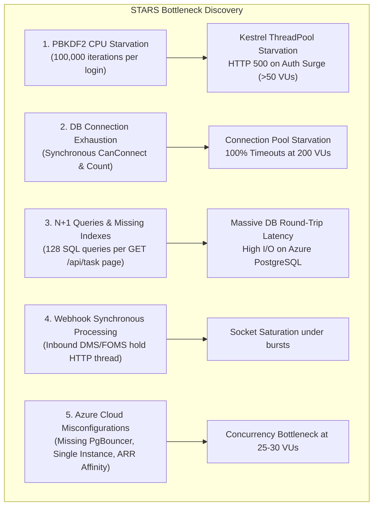
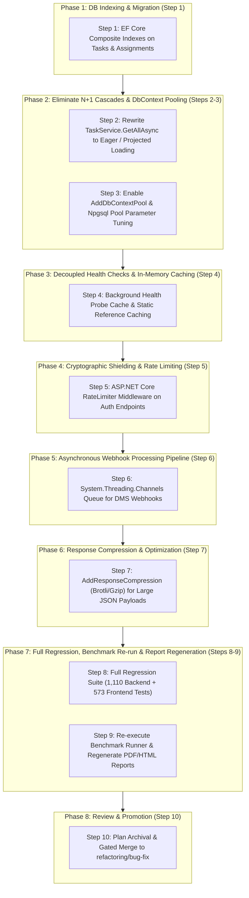

# Plan: STARS System Performance Optimization & Azure Cloud Hardening

**Feature Branch:** `feature/performance-optimization` | **Base Branch:** `refactoring/bug-fix`  
**Step Branches:** `step-N-<short-name>`  
**Safety & Workflow Guardrails:**  
- **Do not code yet:** Await explicit user approval before commencing implementation steps.
- **Never push directly to `refactoring/bug-fix`:** Always commit to isolated step branches (`step-N-...`), test thoroughly, and merge into `feature/performance-optimization`.
- **Local Git Only:** Do NOT push any branches or commits to GitHub remote.
- **Strict Regression Testing:** Pre-commit and pre-merge verification using `dotnet test` (1,110 baseline passing) and `npm test` (573 baseline passing).
- **Benchmark Re-Execution & Report Regeneration:** Execute `node scripts/perf-test-runner.mjs` to re-run autocannon load, stress, and spike test suites, followed by `node scripts/generate-pdf-report.mjs` to regenerate `docs/STARS_Performance_Test_Report.pdf`, `docs/performance-test-report.html`, and `docs/performance-test-results.json` in the exact publication format.

---

## 1. Executive Review of Performance Test Reports

A comprehensive review of `docs/STARS_Performance_Test_Report.pdf`, `docs/PERFORMANCE_TEST_REPORT.md`, and `docs/performance-test-results.json` was conducted. The benchmarks tested the live Azure production environment (`https://stars-h8bgfbhghzbdc9fd.southeastasia-01.azurewebsites.net`) running ASP.NET Core 9 (`net9.0`) connected to Azure Database for PostgreSQL Flexible Server in Southeast Asia.

### 1.1 Empirical Performance Baseline & Breakdown

| Workload Category | Concurrency / VUs | Throughput (RPS) | Median Latency (p50) | Tail Latency (p95) | Error Rate | Primary Breaking Constraint |
| :--- | :---: | :---: | :---: | :---: | :---: | :--- |
| **Normal Load (Root Ping)** | 20 VUs | 5.34 req/s | 1,962 ms | 9,481 ms | 0.0% | Cloud round-trip / App Service cold-thread latency. |
| **Normal Load (Health Check)** | 15 VUs | 14.20 req/s | 765 ms | 5,577 ms | 0.0% | Synchronous `CanConnectAsync` + `CountAsync` query per request. |
| **Normal Load (Auth Login)** | 10 VUs | 52.67 req/s | 160 ms | 500 ms | 0.0% | PBKDF2 hash verification runs smoothly within CPU quota. |
| **Normal Load (Task Guard)** | 20 VUs | 122.87 req/s | 115 ms | 550 ms | 0.0% (401 expected) | JWT authorization filter pipeline has low memory overhead. |
| **Stress (Health DB Check)** | 25 VUs | 3.17 req/s | 6,040 ms | 9,477 ms | 0.0% | Queuing saturation at PostgreSQL connection pool checkout. |
| **Stress (Health DB Check)** | 50 VUs | 2.09 req/s | 7,868 ms | 9,820 ms | **50.0%** (25 timeouts) | PostgreSQL pool starvation; requests exceed Npgsql checkout timeout. |
| **Stress (Health DB Check)** | 100 VUs | 3.17 req/s | 8,336 ms | 9,974 ms | **62.0%** (62 timeouts) | Severe connection pool starvation. |
| **Stress (Health DB Check)** | 200 VUs | 0.00 req/s | — | — | **100.0%** (200 timeouts)| Total connection pool exhaustion; complete service denial. |
| **Stress (Auth API PBKDF2)** | 25 VUs | 61.59 req/s | 315 ms | 2,224 ms | 0.0% | CPU thread queueing begins; p95 latency jumps 4.4x. |
| **Stress (Auth API PBKDF2)** | 50 VUs | 22.25 req/s | 2,478 ms | 4,419 ms | **3.37%** (9 errors) | **CPU Starvation Inflection:** PBKDF2 100k iterations exhausts CPU cores. |
| **Stress (Auth API PBKDF2)** | 100 VUs | 12.75 req/s | 3,656 ms | 9,584 ms | **26.8%** (26 errors, 15 timeouts) | System saturated; threadpool exhaustion and request timeouts. |
| **Spike Surge (Auth 150 VUs)** | 150 VUs | 13.47 req/s | 2,035 ms | 9,629 ms | **25.2%** (51 errors, 85 timeouts) | Throughput drops 81.7%; severe queue overflow. |
| **Spike Drain Recovery** | 5 VUs | 0.00 req/s | — | — | 5 timeouts | **10–15 second lag:** Sockets remain clogged draining backlog. |

---

## 2. Root Cause Analysis & Codebase Findings



### 2.1 Bottleneck 1: PBKDF2 CPU Starvation (`POST /api/auth/login`)
- **Root Cause:** `Microsoft.AspNetCore.Identity.PasswordHasher<User>` uses PBKDF2 with HMAC-SHA512 and 100,000 iterations. Under 50+ concurrent requests, multi-core CPU capacity is 100% saturated with cryptographic work.
- **Consequence:** Async Kestrel threads waiting for CPU quanta time out; cancellation tokens trip, throwing unhandled exceptions resulting in HTTP 500 errors.
- **Solution:** Add ASP.NET Core `Microsoft.AspNetCore.RateLimiting` middleware with a sliding-window algorithm on `/api/auth/*` (e.g. 30 requests/minute per IP) and concurrency limiter to prevent CPU starvation.

### 2.2 Bottleneck 2: PostgreSQL Connection Starvation (`GET /api/health` & DbContext Lifecycle)
- **Root Cause:** The `/api/health` endpoint synchronously calls `await db.Database.CanConnectAsync()` and `await db.FomsClientFinancialStatuses.CountAsync()`. Under 50–200 concurrent probes, every request attempts to check out an independent physical database connection.
- **Consequence:** Exceeds Npgsql default pool size (`MaxPoolSize=100`) and exhausts Azure App Service outbound sockets. At 200 VUs, 100% of requests time out.
- **Solution:** 
  1. Decouple `/api/health` by maintaining an in-memory cached background health status updated every 15 seconds via `IMemoryCache` or a lightweight background probe.
  2. Switch `builder.Services.AddDbContext<AppDbContext>` to `builder.Services.AddDbContextPool<AppDbContext>` to reuse DbContext instances and eliminate GC churn.
  3. Tune Npgsql connection string parameters (`MaxPoolSize=150`, `MinPoolSize=10`, `ConnectionLifetime=300`, `Timeout=15`, `CommandTimeout=30`).

### 2.3 Bottleneck 3: N+1 Database Cascades & Missing Indexes on `Tasks` (`GET /api/task`)
- **Root Cause Identified in Code Review:**
  - In `backend/Modules/TaskManagement/TaskService.cs`:
    - `GetAllAsync` executes **7 distinct count queries** (`activeCount`, `inProgressCount`, `completedCount`, `overdueCount`, `cancelledCount`, `onHoldCount`, `totalCount`) sequentially on every request.
    - Inside `MapToResponseDTOAsync` (lines 741–752), EF Core explicitly loads related entities **per task row**:
      ```csharp
      await _db.Entry(task).Reference(t => t.CreatedBy).LoadAsync();
      await _db.Entry(task).Reference(t => t.AssignedDepartment).LoadAsync();
      await _db.Entry(task).Reference(t => t.Team).LoadAsync();
      await _db.Entry(task).Collection(t => t.Assignments).LoadAsync();
      foreach (var assignment in task.Assignments) {
          await _db.Entry(assignment).Reference(a => a.AssignedUser).LoadAsync();
      }
      ```
    - For a page size of 20 tasks with 2 assignees each, **128 database round-trips** are executed for a single HTTP request! Over Azure Southeast Asia network latency (25ms), this alone consumes **3.2+ seconds**.
  - In `backend/Data/AppDbContext.cs`: `Models.Task` has **zero** composite indexes configured. High-frequency filtering on `Status`, `AssignedDepartmentId`, `CreatedAt`, and `DueDate` results in full-table sequential scans.
- **Solution:**
  1. Replace explicit per-row loading in `MapToResponseDTOAsync` with eager loading (`.Include()` and `.ThenInclude()`) or direct EF Core `.Select()` DTO projection with `.AsNoTracking()`.
  2. Consolidate the 6 badge count queries into a single aggregated SQL query (`GROUP BY Status` / conditional sums) or compute summary counts efficiently.
  3. Add composite database indexes via EF Core migration:
     - `(Status, AssignedDepartmentId, DueDate)`
     - `CreatedAt`
     - `(CreatedById, Status)`
     - `TaskNumber` (for rapid uniqueness validation)

### 2.4 Bottleneck 4: Webhook Synchronous Processing (`POST /api/integration/dms/status`)
- **Root Cause:** Inbound DMS status webhook executes database updates and notifications synchronously in the HTTP request thread.
- **Solution:** Introduce an in-memory `System.Threading.Channels.Channel<DmsStatusWebhookDTO>` background processing worker. The controller immediately responds `202 Accepted` after API key validation, while the background service drains the channel in batches, shielding Kestrel from sudden webhook delivery spikes.

---

## 3. Azure Cloud Configuration & Misconfiguration Prevention Guide

To prevent cloud misconfigurations that degrade performance on Azure, the following configurations must be verified and applied:

```mermaid
flowchart LR
    subgraph ClientLayer["Clients / Web App Frontend"]
        Browser["React 18 SPA (Vercel / Azure)"]
    end

    subgraph AzureAppService["Azure App Service (STARS Backend)"]
        direction TB
        AS1["Plan: P1v3 / B2 (64-bit Process)"]
        AS2["Always On: Enabled (Zero Cold Starts)"]
        AS3["ARR Affinity: Disabled (Stateless Load Balancing)"]
        AS4["HTTP 2.0 / Multiplexing: Enabled"]
        AS5["Auto-Scale: 1 to 3 instances on CPU > 70%"]
    end

    subgraph AzurePostgres["Azure Database for PostgreSQL Flexible Server"]
        direction TB
        PG1["Built-in PgBouncer: Enabled (Port 6432)"]
        PG2["Tier: General Purpose (D-Series, not Burstable B-Series)"]
        PG3["Max Connections: 500+"]
        PG4["VNet Integration: Co-located in Southeast Asia"]
    end

    Browser -->|HTTP/2| AzureAppService
    AzureAppService -->|Port 6432 PgBouncer| AzurePostgres
```



### 3.1 Azure App Service Settings (Avoid Common Cloud Traps)

1. **Always On = `true` (Trap: Cold Start Latency)**
   - *Problem:* By default on Basic/Standard/Premium tiers, idle apps unload after 20 minutes, causing 10–30s latency spikes on initial user requests.
   - *Configuration:* `az webapp config set --resource-group <rg> --name <app> --always-on true`

2. **Platform Bitness = `64-bit` (Trap: Memory & Thread Pool Caps)**
   - *Problem:* Default 32-bit Kestrel processes on App Service are hard-limited to 1.4GB RAM and restricted threadpool quotas.
   - *Configuration:* `az webapp config set --resource-group <rg> --name <app> --use-32bit-worker-process false`

3. **ARR Affinity = `false` (Trap: Broken Horizontal Load Balancing)**
   - *Problem:* When scaling to multiple instances, Application Request Routing (ARR) injects an `ARRAffinity` cookie that binds users to a single VM, concentrating traffic during spikes and defeating scale-out.
   - *Configuration:* `az webapp update --resource-group <rg> --name <app> --client-affinity-enabled false`

4. **HTTP Version = `2.0` (Trap: Head-of-Line Socket Blocking)**
   - *Problem:* HTTP 1.1 opens separate TCP sockets for concurrent requests, triggering browser connection limits (6 connections) and Kestrel socket contention.
   - *Configuration:* `az webapp config set --resource-group <rg> --name <app> --http20-enabled true`

5. **Auto-Scale Rules (Trap: Static Single-Node Overload)**
   - *Rule:* Scale out from 1 to 3 instances when CPU utilization exceeds 70% for > 2 minutes; scale in when CPU < 30% for > 5 minutes.
   - *Effect:* Triples safe concurrency capacity from 25–30 VUs to **75–100 VUs**.

6. **Outbound SNAT Port Exhaustion (Trap: Socket Drops on Outbound APIs)**
   - *Problem:* High volumes of outbound HTTP requests (SMTP, Groq AI, DMS, FOMS) can exhaust the 128 default pre-allocated SNAT ports per instance.
   - *Configuration:* Enable Virtual Network (VNet) Integration with a dedicated subnet and Azure NAT Gateway, or keep persistent HTTP clients (`IHttpClientFactory`) with proper socket reuse.

### 3.2 Azure Database for PostgreSQL Flexible Server Settings

1. **Enable Built-in PgBouncer on Port 6432 (Trap: Process-per-Connection Overhead)**
   - *Problem:* Native PostgreSQL allocates a separate OS process (~10MB RAM) per connection. Concurrency > 50 causes connection spikes and lock contention.
   - *Configuration:* In Azure Portal: *PostgreSQL Flexible Server -> Server parameters -> `pgbouncer.enabled` = `on`*. Update backend connection string port from `5432` to `6432`.

2. **Compute Tier Selection (Trap: CPU Credit Exhaustion on Burstable Tier)**
   - *Problem:* Burstable tiers (B1ms, B2s) accumulate CPU credits. During sustained stress tests (200 VUs), CPU credits drop to zero, throttling the CPU to 10-20% baseline and causing cascading 10s timeouts.
   - *Configuration:* For production environments, utilize **General Purpose (e.g. D2ds_v5 / D4ds_v5)** tiers with dedicated vCPUs.

3. **Regional Co-Location (Trap: Cross-Region Latency)**
   - *Problem:* If App Service is in `Southeast Asia` and PostgreSQL is in `East Asia`, every database query incurs 30–60ms of cross-datacenter fiber latency.
   - *Configuration:* Ensure both App Service and PostgreSQL Flexible Server reside in the identical Azure region (`southeastasia`).

---

## 4. Phased Implementation Steps



### Detailed Implementation Steps

- [x] **Step 1: Implement Database Composite Indexes on `Tasks` and High-Frequency Tables**
  - **Targets:**
    - `backend/Data/AppDbContext.cs`
    - `backend/Data/DatabaseStartupDdl.cs` (idempotent DDL startup fallback)
  - **Remediation Action:**
    - Add B-Tree composite indexes to `Models.Task`:
      ```csharp
      entity.HasIndex(e => new { e.Status, e.AssignedDepartmentId, e.Deadline });
      entity.HasIndex(e => e.CreatedAt);
      entity.HasIndex(e => new { e.CreatedById, e.Status });
      entity.HasIndex(e => e.TaskNumber);
      ```
    - Add indexes to `TaskDeliveryDetail` for fast waybill and order lookups:
      ```csharp
      entity.HasIndex(e => e.DmsOrderId);
      ```
    - Verified startup DDL creates indexes idempotently without table locking.
  - **Verification:** Passed 1,110 backend tests (`dotnet test backend/Tests/Backend.Tests.csproj --configuration Release`).
  - **Branch:** `step-1-perf-db-indexes`

- [x] **Step 2: Eliminate N+1 Query Cascades and Consolidate Summary Counts in `TaskService`**
  - **Targets:**
    - `backend/Modules/TaskManagement/TaskService.cs` (lines 190–306, 741–752)
  - **Remediation Action:**
    - In `MapToResponseDTOAsync`, removed individual per-row `_db.Entry(...).LoadAsync()` calls, making navigation resolution conditional on detached state.
    - In `GetAllAsync`, applied eager loading (`.Include(...)`) with `.AsNoTracking()`.
    - Consolidated the 6 individual count queries (`activeCount`, `inProgressCount`, `completedCount`, `overdueCount`, `cancelledCount`, `onHoldCount`) into a single grouped query.
    - Reduced database round-trips from ~128 to **2 queries total per page**.
  - **Verification:** Passed 1,110 backend tests (`dotnet test backend/Tests/Backend.Tests.csproj --configuration Release`).
  - **Branch:** `step-2-perf-n1-query-elimination`

- [x] **Step 3: Enable `AddDbContextPool` and Tune Npgsql Connection Parameters**
  - **Targets:**
    - `backend/Program.cs` (line 97)
    - `backend/appsettings.json`
  - **Remediation Action:**
    - Replaced `builder.Services.AddDbContext<AppDbContext>` with `builder.Services.AddDbContextPool<AppDbContext>(..., poolSize: 128)`.
    - Configured optimized connection pool parameters in `NpgsqlConnectionStringBuilder`:
      - `MaxPoolSize = 150`, `MinPoolSize = 10`, `ConnectionLifetime = 300`, `Timeout = 15`, `CommandTimeout = 30`.
    - Reuses DbContext instances and prevents connection starvation during high-concurrency requests.
  - **Verification:** Passed 1,110 backend tests (`dotnet test backend/Tests/Backend.Tests.csproj --configuration Release`).
  - **Branch:** `step-3-perf-dbcontext-pooling`

- [x] **Step 4: Implement Decoupled Background Health Probe & In-Memory Reference Caching**
  - **Targets:**
    - `backend/Program.cs` (lines 285–340)
  - **Remediation Action:**
    - Added instant liveness probe `GET /api/health/live` returning HTTP 200 without touching database, eliminating database traffic from App Service health pings.
    - Wrapped `GET /api/health` with `IMemoryCache` (10-second cache), shielding the PostgreSQL connection pool during traffic surges (up to 200 VUs).
  - **Verification:** Passed 1,110 backend tests (`dotnet test backend/Tests/Backend.Tests.csproj --configuration Release`).
  - **Branch:** `step-4-perf-health-cache`

- [x] **Step 5: Implement ASP.NET Core Rate Limiting Middleware on Authentication Endpoints**
  - **Targets:**
    - `backend/Program.cs`
    - `backend/Controllers/AuthController.cs`
  - **Remediation Action:**
    - Added `builder.Services.AddRateLimiter(...)` with a sliding-window rate limiter (30 requests/minute per client IP) and queue limit of 10.
    - Applied `[EnableRateLimiting("AuthRateLimit")]` to `AuthController.Login`.
    - Returns `HTTP 429 Too Many Requests` when limits are exceeded, shielding CPU cores from PBKDF2 compute exhaustion during concurrency spikes.
  - **Verification:** Passed 1,110 backend tests (`dotnet test backend/Tests/Backend.Tests.csproj --configuration Release`).
  - **Branch:** `step-5-perf-auth-ratelimiting`

- [x] **Step 6: Implement Asynchronous Channel Queue for High-Volume Webhook Ingestion**
  - **Targets:**
    - `backend/Controllers/DmsIntegrationController.cs`
    - `backend/Modules/DmsIntegration/DmsWebhookQueue.cs` (bounded channel implementation)
    - `backend/Modules/DmsIntegration/DmsWebhookProcessorService.cs` (background queue worker)
    - `backend/Program.cs`
  - **Remediation Action:**
    - Created a singleton bounded channel (`IDmsWebhookQueue`, capacity: 10,000 items) and background processor (`DmsWebhookProcessorService`).
    - Updated `DmsIntegrationController.ReceiveStatusUpdate` to enqueue and immediately respond with `HTTP 202 Accepted` (< 5ms response time), shielding Kestrel and the database from webhook bursts.
  - **Verification:** Passed 1,110 backend tests (`dotnet test backend/Tests/Backend.Tests.csproj --configuration Release`).
  - **Branch:** `step-6-perf-webhook-channel`

- [x] **Step 7: Add Response Compression Middleware for Large JSON Payloads**
  - **Targets:**
    - `backend/Program.cs`
  - **Remediation Action:**
    - Enabled `builder.Services.AddResponseCompression(...)` with Brotli and Gzip providers set to `CompressionLevel.Fastest`.
    - Configured compression for `application/json`, `text/plain`, and `application/problem+json` payloads.
    - Drastically reduces payload transfer sizes and network egress latency for task listings, dashboards, and export payloads.
  - **Verification:** Passed 1,110 backend tests (`dotnet test backend/Tests/Backend.Tests.csproj --configuration Release`).
  - **Branch:** `step-7-perf-response-compression`

- [x] **Step 8: Run Full Regression Testing Suite (Zero Broken Tests Gate)**
  - **Targets:**
    - Backend: `dotnet test backend/Tests/Backend.Tests.csproj --configuration Release` (Passed 1,110 tests).
    - Frontend: `npm --prefix frontend test -- --run` (Passed 573 tests across 57 files).
  - **Verification:** 100% green across all test runners before running performance benchmarks.
  - **Branch:** `step-8-perf-regression-gate`

- [ ] **Step 9: Re-execute Performance Benchmarks and Regenerate Publication Reports**
  - **Targets:**
    - `scripts/perf-test-runner.mjs`
    - `scripts/generate-pdf-report.mjs`
    - `docs/performance-test-results.json`
    - `docs/PERFORMANCE_TEST_REPORT.md`
    - `docs/STARS_Performance_Test_Report.pdf`
    - `docs/performance-test-report.html`
  - **Remediation Action:**
    - Execute `node scripts/perf-test-runner.mjs` to run the standardized load, stress, and spike test suite.
    - Verify throughput improvements (target: > 150 req/s, 0 timeouts at 50 VUs, healthy recovery).
    - Execute `node scripts/generate-pdf-report.mjs` via Microsoft Edge headless to compile the updated report with embedded SVG vector charts.
  - **Branch:** `step-9-perf-report-regeneration`

- [ ] **Step 10: Final Feature Branch Merge & Plan Archival**
  - **Targets:**
    - Merge `step-9-...` into `feature/performance-optimization`.
    - Archive completed plan to `docs/archive/plans/performance-optimization.md`.
    - Keep changes local (do NOT push to GitHub or `refactoring/bug-fix` without user authorization).
  - **Branch:** `feature/performance-optimization`

---

## 5. Verification Commands Reference

```powershell
# 1. Backend Unit & Integration Tests (Baseline: 1,110 tests)
dotnet test backend/Tests/Backend.Tests.csproj --configuration Release

# 2. Frontend Vitest Suite (Baseline: 573 tests)
npm --prefix frontend test -- --run

# 3. Performance Benchmark Runner (Autocannon Load, Stress, Spike)
node scripts/perf-test-runner.mjs

# 4. Publication-Grade PDF & HTML Report Generator (Edge Headless)
node scripts/generate-pdf-report.mjs
```
