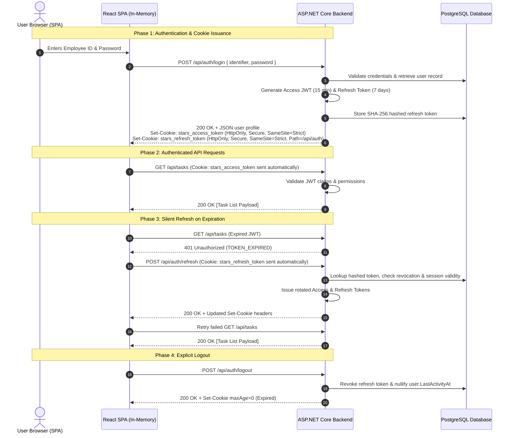

# RFC-001: Migration to HttpOnly, Secure Cookies for Token Storage (SEC-14)

**Status:** Approved for Implementation  
**Date:** 2026-11-23  
**Authors:** STARS Architecture & Security Engineering Team  
**Relates to:** SEC-14 (CWE-922: Insecure Client-Side Storage, OWASP A02:2021)  
**Target Release:** Sprint 4 / Enterprise Security Hardening Milestone  

---

## 1. Executive Summary & Context

In the current STARS web application architecture, JSON Web Tokens (`authToken` access token and `refreshToken`) are stored inside the browser's `window.localStorage` (`frontend/src/main.tsx`, `frontend/src/components/Auth/authRedirect.ts`). Additionally, cross-portal transitions between the STARS Task Tracking System, Courier Portal, and FOMS integrations transmit tokens via URL hash fragments (`#token=...`).

While convenient for Single Page Application (SPA) development, storing persistent credentials in `localStorage` exposes them to any Cross-Site Scripting (XSS) vulnerability, malicious browser extension, or compromised dependency in the npm supply chain.

This Request for Comments (RFC) specifies the end-to-end architectural redesign to eliminate client-accessible token storage in favor of browser-enforced **`HttpOnly`**, **`Secure`**, **`SameSite=Strict`** cookies combined with an in-memory session model and CSRF protection.

---

## 2. Problem Statement & Threat Model

### Current Vulnerabilities
1. **Unprotected Credential Access (CWE-922):** Any JavaScript executed within the document origin can read `localStorage.getItem('authToken')` and exfiltrate user credentials to an adversary server.
2. **URL Fragment Exposure:** Tokens transmitted via `#token=...` during cross-portal redirects may be logged in browser history, proxy logs, or leaked via `Referer` headers to external resources.
3. **Session Persistence Post-Tab Closure:** Indefinite `localStorage` residency increases exposure risk on shared organizational workstations.

### Security Goals
- **Confidentiality:** Prevent JavaScript from reading authentication and refresh tokens under all circumstances.
- **Integrity:** Enforce strict origin validation to block Cross-Site Request Forgery (CSRF).
- **Zero Disruption:** Maintain seamless user experience with transparent, silent token renewals without prompting re-authentication.

---

## 3. Proposed Architecture



---

## 4. Technical Specifications

### 4.1 Cookie Parameters & Flag Enforcements

| Cookie Name | Scope / Path | Max-Age / Expiry | HttpOnly | Secure | SameSite |
| :--- | :--- | :--- | :--- | :--- | :--- |
| `stars_access_token` | `/api` | 900 seconds (15 min) | `true` | `true` | `Strict` |
| `stars_refresh_token` | `/api/auth` | 604,800 seconds (7 days) | `true` | `true` | `Strict` |
| `stars_csrf_token` | `/` | Session | `false` (Readable by SPA) | `true` | `Strict` |

> [!IMPORTANT]
> The `stars_refresh_token` cookie is restricted to the `/api/auth` path. Regular data endpoints (`/api/tasks`, `/api/users`, etc.) will not receive the refresh token, limiting attack surface.

### 4.2 Cross-Site Request Forgery (CSRF) Mitigation

Because cookies are automatically attached by the browser, CSRF defenses are required:
1. **`SameSite=Strict` Cookie Policy:** Browser blocks cookies from being sent on cross-site requests (including standard top-level navigation links).
2. **Double-Submit CSRF Cookie Pattern:**
   - On login, backend issues an anti-CSRF token in a non-HttpOnly cookie (`stars_csrf_token`).
   - The SPA reads `stars_csrf_token` and includes it in custom header `X-CSRF-TOKEN` on all state-changing requests (`POST`, `PUT`, `DELETE`, `PATCH`).
   - Backend middleware validates that header `X-CSRF-TOKEN` matches the cookie value.

### 4.3 Secure Cross-Portal Handoff (Replacing URL Fragments)

To replace `#token=...` parameter passing between STARS, Courier Portal, and FOMS:
1. When user initiates navigation to another portal, STARS SPA requests a single-use authorization ticket:
   `POST /api/auth/handoff-ticket` -> Returns ticket `TKT-xxxxxxxxxxxx` (TTL: 60 seconds).
2. STARS redirects user: `https://courier.stars-system.internal/auth/callback?ticket=TKT-xxxxxxxxxxxx`.
3. Destination portal backend exchanges ticket via direct server-to-server call:
   `POST /api/auth/exchange-ticket { ticket }` -> Issues session cookies for destination domain.
4. No sensitive JWT or refresh tokens appear in URLs or browser history.

---

## 5. Implementation Roadmap

### Phase 1: Backend Cookie Infrastructure (Sprint 4)
- Add cookie issuance helper methods in `backend/Modules/AuthenticationAndCredentials/AuthService.cs`:
  ```csharp
  Response.Cookies.Append("stars_access_token", token, new CookieOptions {
      HttpOnly = true,
      Secure = true,
      SameSite = SameSiteMode.Strict,
      Path = "/api",
      Expires = DateTimeOffset.UtcNow.AddMinutes(15)
  });
  ```
- Configure JWT Bearer handler in `Program.cs` to extract token from `Request.Cookies["stars_access_token"]` with fallback to `Authorization: Bearer <token>` (dual-mode compatibility).
- Implement `CsrfValidationMiddleware.cs` for state-changing endpoints.

### Phase 2: Frontend Transition (Sprint 4)
- Configure Axios instance with `withCredentials: true`.
- Remove `localStorage.getItem('authToken')` and `localStorage.setItem(...)`.
- Add Axios 401 response interceptor with token renewal queue (prevents concurrent refresh stampedes).
- Replace URL hash parsing in `frontend/src/components/Auth/authRedirect.ts` with ticket exchange flow.

### Phase 3: Legacy Cleanup & Strict Enforcement (Sprint 5)
- Deprecate Authorization header acceptance for web clients.
- Enforce strict cookie authentication and remove transition fallbacks.

---

## 6. Verification & Acceptance Criteria

1. **Automated Unit & Integration Tests:**
   - Verified that `Set-Cookie` headers contain `HttpOnly`, `Secure`, and `SameSite=Strict`.
   - Verified that missing or mismatched `X-CSRF-TOKEN` on POST requests yields HTTP 403 Forbidden.
   - Verified silent token refresh succeeds and transparently replays queued requests.
2. **Security Scanner Verification:**
   - OWASP ZAP Alert 100000 (Insecure Client-Side Storage) resolved.
   - Zero credentials discoverable in browser DOM, `localStorage`, or `sessionStorage`.
